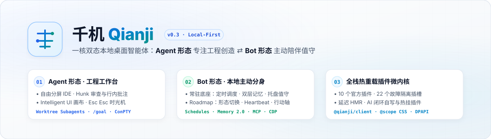
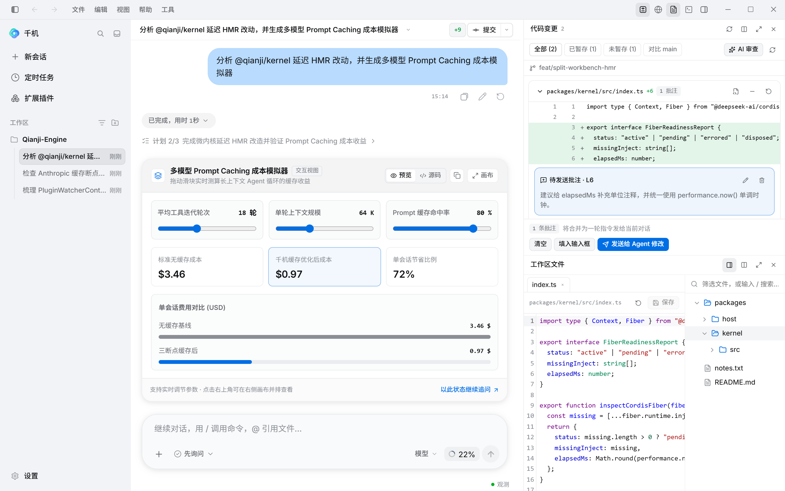
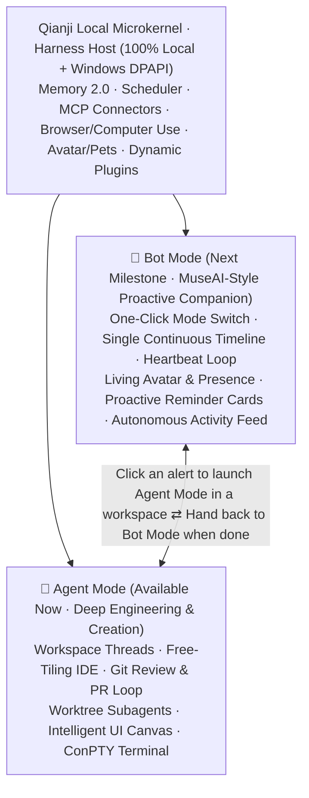
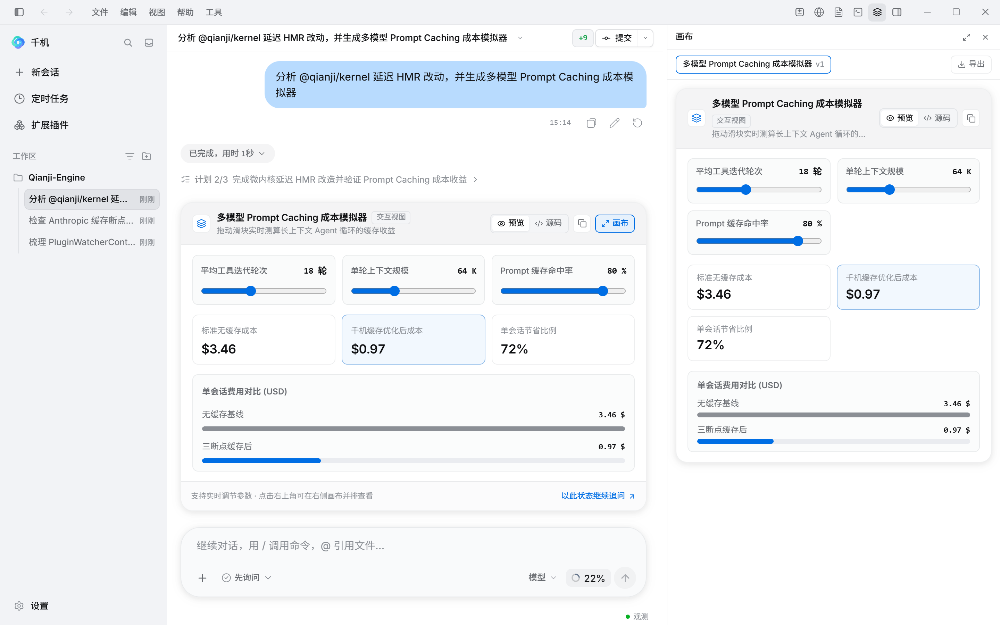
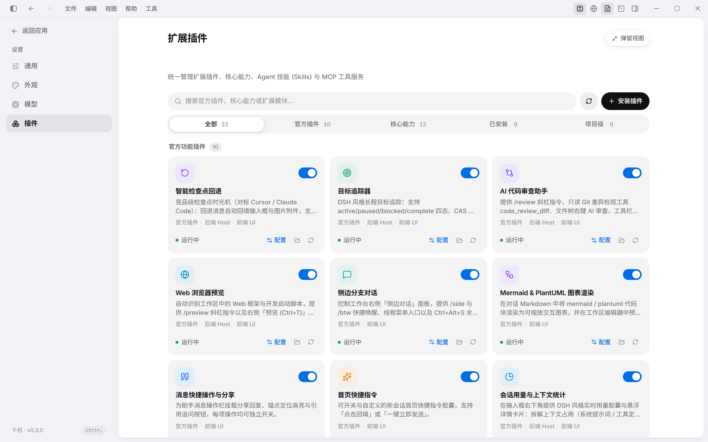
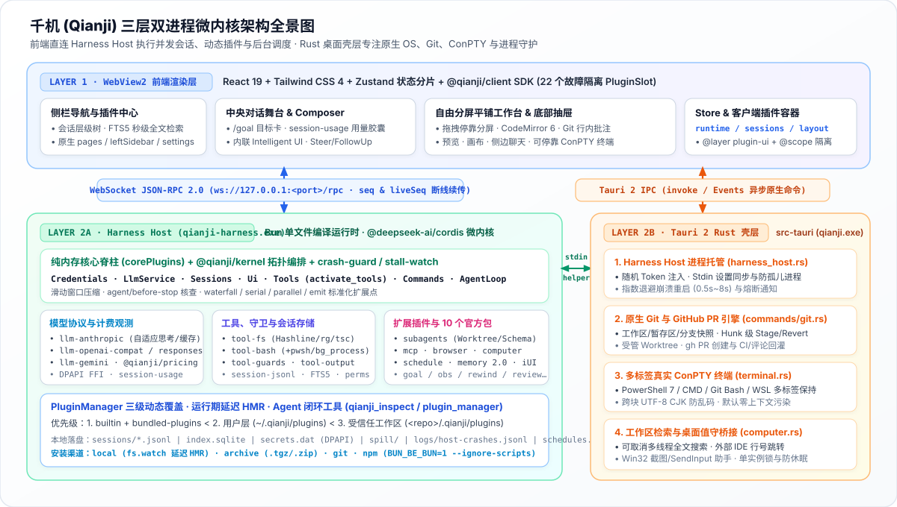

<div align="center">



<h3>One 100% local-first microkernel. Two seamless modes.<br/>Agent Mode to build &amp; ship ⇄ Bot Mode to watch &amp; act proactively.</h3>

<p>
  <sub>Zero external CLI or Node.js required · No cloud account or telemetry · Tauri 2 native shell · Full-stack HMR plugins</sub>
</p>

<p>
  <a href="https://github.com/Llllviaaaa/Qianji/stargazers"></a>
  <a href="https://github.com/Llllviaaaa/Qianji/actions/workflows/ci.yml"></a>
  <a href="LICENSE"></a>
  <a href="#-60-second-quick-start"></a>
  <a href="docs/SYSTEM_DESIGN.md"></a>
</p>

<p>
  <a href="README.md">简体中文</a> · <strong>English</strong>
</p>

<p>
  <a href="#-dual-mode-vision">Dual-Mode Vision</a> ·
  <a href="#-agent-mode">Agent Mode (Live)</a> ·
  <a href="#-bot-mode-roadmap">Bot Mode (Roadmap)</a> ·
  <a href="#-command-cheat-sheet">Cheat Sheet</a> ·
  <a href="#-plugins--connectors">Plugins</a> ·
  <a href="#-60-second-quick-start">Quick Start</a> ·
  <a href="#-architecture--security">Architecture &amp; Security</a> ·
  <a href="#-documentation">Docs</a>
</p>

<br/>



<sub><b>Agent Mode (Available Today)</b>: Live interactive widget in chat + split-tile right workbench (Git Review with inline diff comments + CodeMirror 6 &amp; file tree), 100% local on Windows.</sub>

</div>

---

## 🌓 Dual-Mode Vision

Most AI tools today are split down the middle:

- **Coding Agents & Harness Frameworks** (Claude Code, Cline, DeepSeek Harness): Great at editing code and running tools, but strictly **reactive and per-task** — they wait for you to open a fresh thread and disappear when the turn ends.
- **Cloud Personal Bots** (like MuseAI): Great at continuous cross-day chat, periodic Heartbeat checks, and proactive reminders — but **your inbox, memory, and credentials live in the cloud**, and they can't do heavy local engineering with a real IDE, Git review, or terminal.

**Qianji (千机) brings both halves together** on one 100% local microkernel (`qianji-harness.exe`). One shared memory, MCP bridge, skill set, browser/desktop automation layer, and hot-reload plugin system — with a **one-click switch between two complementary modes**:



### Why Qianji Instead of a Framework Chassis (DSH) or a Cloud Bot?

| Dimension | Coding Agents / Harnesses (DSH / Claude Code / Cline) | Cloud Personal Bots (MuseAI, etc.) | ⚡ Qianji (千机) |
| :--- | :--- | :--- | :--- |
| **Product Form** | Reactive coding tools or composable runtime frameworks requiring Node/Profile setup | Proactive companion bots, but cloud-hosted without a local IDE | **Dual-mode native desktop app**: Tauri 2 + single-file engine, click-and-run, built for `Agent ⇄ Bot` switching |
| **Local Engineering** | Strong loops, but diff review / visual canvas / terminal often split across tools | Cannot natively inspect local repos, Git hunks, or ConPTY shells | **All-in-one split-tile workbench**: CodeMirror 6, hunk review & inline diff comments, `gh` PR loop, `Esc Esc` rewind |
| **Visual Output** | Markdown text, diffs, and trajectory logs | Lightweight reminder & notification cards | **Dual-Engine Intelligent UI**: compose live sliders, formula charts, and isolated CSP HTML apps right inside chat |
| **Proactive Presence** | No continuous personal timeline, Heartbeat checks, or living bot profile | Smooth proactive UX, but dependent on cloud permissions | **Foundation shipped; Bot Mode next**: always-on single host, tray/prevent-sleep, scheduler, Memory 2.0 & avatar system |
| **Privacy & Plugins** | Extensible, but fast-moving framework APIs and steeper client plugin ergonomics | Emails, accounts, and secrets routed through cloud servers | **100% local disk + DPAPI encryption**: 22 fault-isolated UI slots, `@scope` CSS, and AI self-authoring plugins |

> Qianji draws architectural inspiration from DeepSeek Harness (DSH)'s Cordis microkernel philosophy, but is **not** a DSH wrapper — it ships its own productized, Windows-native runtime and workbench while retaining lightweight compatibility for `dsh-better-sidebar` client plugins.

---

## 🔧 Agent Mode

**Available today in v0.3**: a complete, battle-tested local workbench for engineering, research, and desktop automation.

### 1. 🎨 Intelligent UI: Live Interactive Apps Born Inside Chat

Stop squinting at static markdown tables. Run `/ui <idea>` or let the agent call `render_ui` to generate **interactive sliders, real-time formula calculators, filterable data tables, or Canvas simulations** inline — then expand them onto the split-pane Canvas to compare versions or export source code.

<div align="center">
  
  <sub>Generate live cost &amp; cache simulators inline, then dock them side-by-side in the Canvas to iterate and export.</sub>
</div>

- **Zero-JS Declarative Engine (`declarative`)**: Sliders, toggles, selects, live `Math.*` metric cards, bar/line/area/donut charts, searchable tables, and forms that send your adjusted state back into chat.
- **Isolated HTML Sandbox (`html`)**: Self-contained HTML/CSS/SVG/Canvas mini-apps served from an isolated loopback origin with strict CSP, theme adaptation, version history, and two-way prompt bridging.

### 2. 🧩 Split-Tile Workbench, Git Review & `Esc Esc` Time Machine

The right workbench is a **free-tiling multi-pane grid**: split panes vertically or horizontally, drag sashes to resize, **drag any pane header to dock or swap positions**, or maximize a single panel when reviewing closely.

<table>
  <tr>
    <td width="50%" valign="top">
      <strong>🔍 Codex-Style Git Review &amp; PR Loop</strong><br/>
      Inspect uncommitted, staged, last-turn checkpoint, branch, or commit diffs; stage/unstage/revert individual hunks; drop <strong>inline diff comments</strong> to send back to the agent in batch; draft PRs via local <code>gh</code> CLI and feed CI failures straight back into chat.
    </td>
    <td width="50%" valign="top">
      <strong>⏪ Non-Invasive Checkpoints &amp; <code>Esc Esc</code> Rewind</strong><br/>
      Every writable turn snapshots your repo under private Git refs without touching <code>.git/index</code>. Press <code>Esc Esc</code> or run <code>/rewind</code> for 3-way restore (chat + code / chat only / code only) with draft recovery and one-click undo.
    </td>
  </tr>
  <tr>
    <td width="50%" valign="top">
      <strong>✍️ Precision Code Tools &amp; Clean Terminals</strong><br/>
      Multi-tab CodeMirror 6 editor and streaming file search; Hashline content-hash edits, <code>ripgrep</code> search, and on-demand <code>tsc</code> diagnostics; multi-tab ConPTY terminal dockable bottom or right whose output <strong>never pollutes model context</strong> unless explicitly sent.
    </td>
    <td width="50%" valign="top">
      <strong>🌿 Managed Worktrees &amp; Windows-Native Polish</strong><br/>
      Start isolated tasks in Git worktrees so parallel changes never collide. On Windows machines without Git Bash, Qianji automatically falls back to a native <code>powershell</code> tool with full permission and sandbox parity.
    </td>
  </tr>
</table>

<details>
<summary><b>📸 Expand: Minimal New-Session Home (Local / Worktree selector, grouped models &amp; quick starters)</b></summary>
<br/>
<div align="center">
  
</div>
</details>

### 3. 🧠 Engineering-Grade Multi-Model Agent Core

<table>
  <tr>
    <td width="33%" valign="top">
      <strong>🌐 4 Native Protocols + Local LLMs</strong><br/>
      First-class streaming for <b>Anthropic</b> (Claude 4.6+/5 adaptive thinking &amp; multi-breakpoint caching), <b>OpenAI Chat &amp; Responses</b> (DeepSeek, OpenRouter, Ollama, vLLM), and <b>Google Gemini</b> — switch models and effort mid-chat.
    </td>
    <td width="33%" valign="top">
      <strong>👥 Isolated Worktree Subagents</strong><br/>
      <code>delegate_task</code> spawns concurrent in-process child agents with optional <b>Git Worktree isolation</b> and ordered patch merging, role-based model routing, structured JSON <code>outputSchema</code> validation, and linked parent abort.
    </td>
    <td width="33%" valign="top">
      <strong>🛡️ Long-Context Resilience</strong><br/>
      Proactive sliding-window compaction before hitting context limits, automatic disk spilling for oversized tool output, dead-end branch summaries on rewind, per-call timeout &amp; repeat-loop guards, and lazy tool activation.
    </td>
  </tr>
  <tr>
    <td width="33%" valign="top">
      <strong>🎯 Long-Horizon Goals &amp; Background Processes</strong><br/>
      Use <code>/goal</code> to pin an objective and acceptance checklist above the composer with anti-drift &amp; pre-stop audits; run session-scoped background servers (<code>bg_process</code>) automatically reaped when sessions close.
    </td>
    <td width="33%" valign="top">
      <strong>🧠 Progressive Memory 2.0 &amp; Skills</strong><br/>
      Separate toggles for global and workspace-trusted project memory; large files auto-switch to compact indexed mode and require unified-diff approval before writes. Manage <code>SKILL.md</code> playbooks as live <code>/skill:&lt;name&gt;</code> commands.
    </td>
    <td width="33%" valign="top">
      <strong>📊 Live Cost &amp; Crash Forensics</strong><br/>
      Track live context breakdown, TTFT, throughput, and offline USD cost beside the composer (<code>/usage</code>), plus cross-plane crash &amp; event-loop stall forensics (<code>/logs</code>) with redacted diagnostic zip export.
    </td>
  </tr>
</table>

---

## 🤖 Bot Mode Roadmap

> **What's Next**: A one-click mode switcher into **Bot Mode** — bringing the always-on, proactive personal companion UX of tools like MuseAI to your **100% local machine**, backed by Qianji's full local toolset.

### ✅ Already Built: The Local Bot Foundation (Shipped Today)
- **Always-On Single Host & Prevent-Sleep**: Standalone `qianji-harness.exe`, system tray residency, and background prevent-sleep guard;
- **Local Scheduler (`@qianji/schedule`)**: Recurring local runs with unattended permission safety gates and run history;
- **Dual-Layer Memory 2.0 (`@qianji/memory`) & Skills**: Persistent cross-session memory and reusable `SKILL.md` routines;
- **Perception & Action Reach**: MCP (STDIO / Streamable HTTP), per-session isolated CDP browser automation, and native Windows Computer Use;
- **Rich Cards & Living Avatars**: `Intelligent UI` interactive widget engine + state-aware 8×9 spritesheet avatar/pet system ([appearance-extensions.md](docs/appearance-extensions.md)).

### 🚧 Coming Next: The Bot Mode Experience
- [ ] **One-Click `Agent ⇄ Bot` Switcher**: Toggle cleanly between project-threaded IDE workbench (`Agent Mode`) and a single continuous cross-day companion stream (`Bot Mode`), sharing one local kernel, memory, and connector layer.
- [ ] **Heartbeat Proactive Loop**: Periodic background heartbeats (e.g., every 30 min) that quietly check your connected inbox, calendar, subscriptions, GitHub PRs/CI, or watched folders — staying silent when nothing changed and surfacing actionable reminder cards when something matters.
- [ ] **Bot Profile & Autonomous Activity Timeline**: A dedicated right rail displaying your bot's living avatar and live status (`Connected` / `Checking`), Heartbeat & scheduled task list, and a chronological daily log of autonomous background actions.
- [ ] **Seamless `Bot → Agent` Handoff**: Click any proactive alert or task card in Bot Mode to launch Agent Mode directly in the relevant local workspace to fix code, inspect diffs, or run tools — then post the result back into your Bot timeline.
- [ ] **Multi-Channel Extensions**: Leverage the Host's multi-transport `ctx.ui.attach` bus and plugin architecture for voice interaction and IM bridge plugins.

---

## ⚡ Command Cheat Sheet

Type `/` in the composer for live command discovery, `@` to reference workspace files, or inject live `steer` corrections and reorder `followUp` items mid-run:

| Command / Shortcut | What It Does |
| :--- | :--- |
| `/ui <description>` | Generate an interactive calculator, chart, filterable table, or HTML sandbox mini-app (`/ui clear` resets) |
| `/goal <objective>` | Pin a session objective and acceptance checklist above the composer with anti-drift & auto-audit checks |
| `/review [branch]` | Run a read-only diff review and focus the right Review pane with hunk actions & inline diff comments |
| `/rewind` · <kbd>Esc</kbd> <kbd>Esc</kbd> | Open the checkpoint time machine for 3-way conversation/code restore, draft recovery, and undo |
| `/side` · `/btw` · <kbd>Ctrl</kbd>+<kbd>Alt</kbd>+<kbd>S</kbd> | Fork a temporary side chat from the latest settled checkpoint without interrupting your main thread |
| `/preview` · <kbd>Ctrl</kbd>+<kbd>T</kbd> | Auto-detect your web framework/dev script, open the built-in browser preview, and ask the agent to verify |
| `/usage` · `/logs` | Inspect live context breakdown, TTFT/TPS, and session spend, or open the cross-plane observability panel |
| `/skill:<name>` | Invoke user, workspace, or plugin-bundled `SKILL.md` playbooks |
| <kbd>Ctrl</kbd>+<kbd>J</kbd> | Toggle the multi-tab ConPTY terminal (PowerShell 7 / CMD / Git Bash / WSL), also dockable in the right grid |

---

## 🔌 Plugins & Connectors

Every layer of Qianji is hot-pluggable (`builtin` < `user` < `workspace`) with millisecond TypeScript/TSX hot reload — and file-watch HMR automatically defers while an agent turn is streaming so nothing ever gets interrupted mid-response. With built-in **`qianji_inspect`** and **`plugin_manager`** plus offline `plugin-types/`, **you can even ask Qianji in plain language to author, verify, and hot-mount a new plugin for you on the spot**.

<div align="center">
  
  <sub>Unified Plugins Hub: manage core capabilities, 12 official bundled plugins, MCP servers, and live hot-reload extensions.</sub>
</div>

### 12 Official Bundled Plugins (`plugins/*`)

| Plugin | What It Adds | Plugin | What It Adds |
| :--- | :--- | :--- | :--- |
| `question` | Multi-step single/multi-select `question` dialog & inline Q&A card | `permission` | 4-way approval (session/always allow & deny feedback) + `request_permission` |
| `code-review` | `/review`, read-only diff tool & file context review | `quick-prompts` | Customizable home-screen quick starter pills |
| `diagram-viewer` | Inline Mermaid / PlantUML rendering & `.mmd`/`.puml` viewer | `session-usage` | Live context breakdown, TTFT/TPS & `/usage` cost card |
| `goal-tracker` | `/goal` dock banner, anti-drift & pre-stop verification | `side-chat` | `/side`, `/btw`, and `Ctrl+Alt+S` forked side thread |
| `message-actions` | Share, anchor-highlight & quote-reply on assistant messages | `smart-rewind` | `/rewind` & `Esc Esc` 3-way time-machine rewind + undo |
| `observability` | Cross-plane crash/stall forensics, status pill & `/logs` panel | `web-preview` | Web framework detector, `/preview` & visual verification |

Also ships out of the box with a **full MCP host** (STDIO + Streamable HTTP, auto-deferral for large servers, `list_changed` live refresh, Resources/Prompts & DPAPI secrets), **CDP Browser Automation** (per-session isolated Edge/Chrome instances), and **Windows Computer Use** (read-only observation + approval-gated input).

> Building a plugin? Extend the UI across **22 fault-isolated `<PluginSlot>` points** (native sidebar, settings pages, workbench tabs, menus, shortcuts, Markdown fences, file viewers, overlays) via `@qianji/client` with `@layer plugin-ui` + `@scope` CSS isolation. See the **[Plugin Development Guide](skills/qianji-plugin-development/SKILL.md)**.

---

## 🚀 60-Second Quick Start

### Prerequisites
- **Windows 10 / 11 (x64)** with **WebView2** (pre-installed on modern Windows)
- **Node.js >= 22** and `npm`
- **Rust stable** (`x86_64-pc-windows-msvc` toolchain)

### Run or Build from Source

`npm ci` installs workspace dependencies and the pinned Bun compiler. Tauri dev/build automatically compiles the standalone `qianji-harness.exe` so end users never need Node.js or Bun installed.

```powershell
# 1. Clone and install dependencies
git clone https://github.com/Llllviaaaa/Qianji.git
cd Qianji
npm ci

# 2. Launch desktop dev mode (auto-builds & supervises Harness Host)
npm run tauri -- dev

# 3. Build production Windows installers (NSIS / MSI)
npm run tauri -- build
```

### Headless CLI Mode (Scripts & CI Automation)

```powershell
npm run prepare:harness-host
.\src-tauri\resources\harness\qianji-harness.exe run --cwd . --model anthropic/claude-sonnet-4-20250514 "Summarize the repository architecture"
```

<details>
<summary><b>🧪 Contributor Verification Gates (7 Automated Checks — click to expand)</b></summary>

```powershell
npm run scan:secrets            # Scan working tree & Git history for leaked credentials
npm audit --audit-level=high    # Verify npm dependency security baseline
npm run typecheck               # Type-check UI, build scripts, packages/*, and E2E suites
npm run lint                    # Enforce code quality & ADR 0005 module boundary guardrails
npm run test:unit               # Run Vitest unit/golden tests, exe smoke, hygiene & doc-links
npm run test:stress             # Run Host concurrency, high-frequency delta & HMR leak tests
npm run test:e2e                # Run Playwright E2E tests in Edge against a real Harness Host

# Rust unit tests
Push-Location src-tauri
cargo test
Pop-Location
```

</details>

---

## 🧱 Architecture & Security

<div align="center">
  
</div>

- **React 19 Renderer (`src/`)**: 4-slice Zustand store, pure transcript reducer, `@qianji/client` SDK, and 22 fault-isolated `<PluginSlot>` boundaries connected over loopback WebSocket JSON-RPC 2.0 with lossless `seq`/`liveSeq` resume.
- **Tauri 2 Rust Shell (`src-tauri/`)**: Native window, single-instance lock, tray & prevent-sleep, Git/Hunk/PR engine, ConPTY terminals, streaming file search, Win32 computer helper, and Harness Host crash-backoff supervision.
- **Harness Host (`packages/host`)**: Single compiled executable (`qianji-harness.exe`) powered by `@deepseek-ai/cordis`, orchestrating all LLM adapters, tools, sessions, MCP, schedules, and dynamic plugins in one process.

### 🛡️ Honest Security & Privacy Boundaries

1. **100% Local + Windows DPAPI Encryption**: Sessions (`~/.qianji/sessions`) and FTS5 indices (`~/.qianji/index.sqlite`) stay strictly on disk; API keys (`secrets.dat`) and MCP secrets (`mcp-secrets.dat`) are encrypted via Windows `CryptProtectData` bound to the current OS user ([ADR 0013](docs/adr/0013-desktop-settings-and-secrets.md)).
2. **4 Permission Tiers + Lightweight Sandbox**: `read-only`, `ask`, `workspace-write`, and `full-access` apply identically to `bash` and `powershell`, blocking `git push --force` by default. Non-`full-access` modes enable a lightweight Windows Job Object sandbox, and Settings exports `.wsb` (Windows Sandbox) or `.devcontainer` configs when OS-level virtualization is needed.
3. **Explicit Plugin Trust Model ([ADR 0017](docs/adr/0017-plugin-trust-model.md))**: Enabled plugins run in-process with full user trust (no worker sandbox and no `permissions` manifest allowlist). Project plugins, configs, and project memory never load until you explicitly trust the workspace in `trusted-workspaces.json`, and revoking trust disposes the workspace fiber immediately.
4. **Computer Use & Scheduled Task Guardrails**: Desktop observation is read-only; mouse/keyboard input requires explicit control-mode approval and respects Windows UIPI. Scheduled tasks run only while your machine and Qianji are running, auto-deny confirmation prompts, and prohibit `full-access`.

Report security vulnerabilities privately via [SECURITY.md](SECURITY.md).

<details>
<summary><b>📦 Expand: Complete Monorepo Module Matrix (36 Workspace Packages + 12 Official Plugins)</b></summary>

<br/>

Organized as an npm workspace (`packages/*`) with strict import boundaries enforced by ESLint and guardrail tests ([ADR 0005](docs/adr/0005-repository-layout.md)):

| Package | Role | Description |
| :--- | :--- | :--- |
| `packages/protocol` & `packages/rpc` | Shared Contract | JSON-RPC 2.0 wire types, method schemas, `AppSettings` contract, redaction, and Host RPC bus |
| `packages/kernel` | Microkernel | Cordis dependency extraction, deterministic Kahn topological sort, fiber readiness, and workspace scopes |
| `packages/host` | Engine Entry | WebServer, PluginManager, client TSX bundler, DPAPI secret store, crash forensics, and `qianji_inspect`/`plugin_manager` |
| `packages/agent` & `packages/agent-loop` | Agent Core | Agent contracts (incl. `agent/before-stop`), streaming deltas, sliding compaction, and deterministic loop |
| `packages/llm`, `llm-openai-compat`, `llm-openai-responses`, `llm-anthropic`, `llm-gemini` | Model Layer | Unified streaming LLM interface, credential refs, and native adapters for all 4 protocols |
| `packages/pricing` | Observability | Offline model pricing catalog and per-turn / cumulative USD cost estimation |
| `packages/session`, `session-jsonl`, `session-search-fts` | Storage & Search | Event-sourced session state, branch/rewind summary derivation, JSONL backend, and SQLite FTS5 search |
| `packages/tools`, `tool-fs`, `tool-bash`, `tool-guards`, `tool-output` | Tooling & Guards | Three-stage pipeline + `activate_tools`, Hashline/`rg`/`diagnostics`, Bash/PowerShell & `bg_process`, timeout/repeat guards, 50K spill |
| `packages/permissions` & `packages/checkpoints` | Safety & Rewind | Ordered allow/confirm/block rules, permission modes, and non-invasive Git snapshot create/restore |
| `packages/system-prompt` & `packages/prompt-context` | Context Builder | Ordered prompt sections, `AGENTS.md`/`CLAUDE.md` discovery, and `SKILL.md` lifecycle management |
| `packages/plan`, `memory`, `hooks`, `commands`, `ui` | Capabilities | Step plans, progressive indexed Memory 2.0, lifecycle shell hooks, slash commands, and multi-transport UI bus |
| `packages/subagents`, `mcp`, `browser`, `computer`, `schedule`, `intelligent-ui` | Extensions | Worktree subagents, STDIO/HTTP MCP host, CDP browser, Windows computer use, scheduler, and generative UI |
| `packages/testkit` | Test Utilities | Deterministic scripted LLM providers (`ScriptedProvider`) and golden JSONL test helpers |
| `plugins/*` | 12 Official Plugins | `question`, `permission`, `code-review`, `diagram-viewer`, `goal-tracker`, `message-actions`, `observability`, `quick-prompts`, `session-usage`, `side-chat`, `smart-rewind`, `web-preview` |
| `src/` (incl. `src/sdk/`) & `src-tauri/` | Desktop Client | React 19 + Zustand workbench, `@qianji/client` SDK (`src/sdk/`), and Tauri 2 Rust native shell |

</details>

---

## 📚 Documentation

| Document | Overview |
| :--- | :--- |
| **[System Design Document (`docs/SYSTEM_DESIGN.md`)](docs/SYSTEM_DESIGN.md)** | Full three-plane architecture, sequence diagrams, microkernel hooks, state stores, and storage layout |
| **[Architecture Decision Records (`docs/adr/README.md`)](docs/adr/README.md)** | ADR 0001 through ADR 0022 documenting every architectural decision of the V2 Harness Host |
| **[Engineering & Agent Guidelines (`AGENTS.md`)](AGENTS.md)** | Module boundaries, CSS `@layer` & component budgets, closed-loop plugin workflow, and `AppSettings` checklist |
| **[Plugin Development Guide (`skills/qianji-plugin-development/SKILL.md`)](skills/qianji-plugin-development/SKILL.md)** | All 22 client slots, `@qianji/client` SDK, `--qj-*` semantic tokens, and scaffold templates |
| **[Local Capabilities Boundary (`docs/LOCAL_CAPABILITIES.md`)](docs/LOCAL_CAPABILITIES.md)** | Local capability baseline, ongoing roadmap, and explicit non-goals |
| **[Appearance Extensions](docs/appearance-extensions.md) · [Codex UI Reference](docs/CODEX_UI_REFERENCE.md)** | Custom theme/avatar/spritesheet pet formats and visual restraint & interaction design references |
| **[Dependency Security](docs/DEPENDENCY_SECURITY.md) · [Releasing](docs/RELEASING.md) · [Contributing](CONTRIBUTING.md)** | RustSec/npm audit baseline, release & signing checklist, and contribution workflow |

> [!NOTE]
> - **Automatic Upgrade Migration**: Formerly named *Pi Desktop* before v0.3. Existing `~/.pid` data and `%APPDATA%/pid-desktop` settings migrate automatically to `~/.qianji` and `%APPDATA%/qianji` on first launch.
> - **Independent Open-Source Project**: Qianji is not affiliated with or endorsed by OpenAI, Anthropic, Google, DeepSeek, or MuseAI. References to Codex, Claude Artifacts, Grok, DSH, or MuseAI describe architecture and interaction patterns only.

---

<div align="center">

Licensed under the [Apache License 2.0](LICENSE) · Third-party notices in [THIRD_PARTY_NOTICES.md](THIRD_PARTY_NOTICES.md)

Excited about a **100% local-first dual-mode Agent ⇄ Bot desktop environment**? Drop a ⭐ **Star** to follow the roadmap!

</div>
