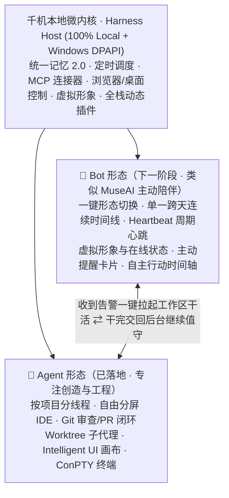

<div align="center">


<h3>一个 100% 本地微内核，一键切换两种形态<br/>Agent 形态专注工程创造 ⇄ Bot 形态主动陪伴值守</h3>

<p>
  <sub>零 Node.js / 外部 CLI 依赖 · 无云端账号与遥测 · Tauri 2 原生桌面 · 全栈热重载插件体系</sub>
</p>

<p>
  <a href="https://github.com/Llllviaaaa/Qianji/stargazers"></a>
  <a href="https://github.com/Llllviaaaa/Qianji/actions/workflows/ci.yml"></a>
  <a href="LICENSE"></a>
  <a href="#-60-秒快速开始"></a>
  <a href="docs/SYSTEM_DESIGN.md"></a>
</p>

<p>
  <strong>简体中文</strong> · <a href="README.en.md">English</a>
</p>

<p>
  <a href="#-一核双态愿景">一核双态</a> ·
  <a href="#-agent-形态">Agent 形态（已可用）</a> ·
  <a href="#-bot-形态路线图">Bot 形态（路线图）</a> ·
  <a href="#-高频指令速查">指令速查</a> ·
  <a href="#-插件与连接器生态">插件生态</a> ·
  <a href="#-60-秒快速开始">快速开始</a> ·
  <a href="#-架构与安全隐私">架构与安全</a> ·
  <a href="#-文档导航">文档导航</a>
</p>

<br/>


<sub><b>当前已落地的 Agent 形态</b>：对话内实时交互模拟器 + 右侧上下分屏工作台（Git Diff 行内批注 + CodeMirror 6 与文件树），全部运行在本地原生窗口内</sub>

</div>

---

## 🌓 一核双态愿景

今天的 AI 工具大多被割裂成了两半：

- **工程 Agent / Harness 框架**（如 Claude Code、Cline、DeepSeek Harness）：擅长改代码、跑工具，但永远是**被动触发、按任务起会话**；用完就关，没有常驻个人形象，也不会在后台替你盯着世界、有事主动找你。
- **云端个人 Bot 伴侣**（如 MuseAI）：有连续跨天对话、Heartbeat 周期巡检和主动提醒卡片，体验很贴心，但**隐私、邮件和凭据都要交给云端**，也干不了本地 IDE、Git 审查、Worktree 并行开发和真实终端的硬核工程活。

**千机（Qianji）想把这两半合而为一**：用一个 100% 本地常驻的微内核引擎（`qianji-harness.exe`），共享同一套长期记忆、MCP 连接器、技能、浏览器/桌面控制与热重载插件，在上层提供**可一键切换的两种工作形态**：



### 为什么选千机，而不是纯框架底座（如 DSH）或云端 Bot？

| 对比维度 | 工程框架 / CLI (DSH / Claude Code / Cline) | 云端个人 Bot (MuseAI 等) | ⚡ 千机 (Qianji) |
| :--- | :--- | :--- | :--- |
| **产品形态** | 被动触发的 Agent 工具或可编程框架底座，常需 Node / Profile 配置 | 主动陪伴的云端聊天 Bot，但缺少本地研发工作台 | **一核双态原生桌面应用**：Tauri 2 + 单文件引擎，双击即用，面向 `Agent ⇄ Bot` 一键切换 |
| **本地硬核研发力** | 强在代码循环，IDE 审查/画布/终端体验往往割裂或靠外部插件拼装 | 几乎无法深入操作本机仓库、Git Hunk 与本地终端 | **一体化自由分屏工作台**：CodeMirror 6、Hunk 审查与行内批注、`gh` PR 闭环、`Esc Esc` 时光机、真终端 |
| **可视化交互** | 以 Markdown 文本和轨迹日志为主 | 轻量提醒与消息卡片为主 | **Intelligent UI 双引擎**：对话里直接长出可调滑块、实时公式图表与隔离 CSP HTML 微应用 |
| **主动值守与陪伴** | 缺少常驻个人时间线、Heartbeat 心跳与分身档案 | 体验成熟，但受限于云端权限与网络环境 | **底座已就绪，Bot 形态演进中**：单进程常驻托盘防休眠、定时任务、双层记忆、桌宠/形象系统已落地 |
| **隐私与扩展性** | 本地可编程，但上游框架演进快、客户端容错门槛偏高 | 账号、邮箱、上下文与密钥依赖云端服务 | **100% 本地硬盘 + DPAPI 加密**：22 个故障隔离 UI 插槽、CSS `@scope` 沙箱，支持让 AI 现场热写插件 |

> 千机在架构上致敬并借鉴了 DeepSeek Harness（DSH）基于 Cordis 的微内核插件化思想，但并非 DSH 套壳——我们自研了面向 Windows 桌面端深度打磨的产品化运行时与原生工作台，同时轻量兼容部分 `dsh-better-sidebar` 纯前端插件。

---

## 🔧 Agent 形态

**当前 v0.3 已完整交付 Agent 形态与全套本地底座**，开箱即可承担真实的日常工程、研究与自动化任务。

### 1. 🎨 Intelligent UI：对话里直接“长出”可交互应用

别再对着静态文字和死表格脑补数字了。输入 `/ui <你的想法>` 或让 Agent 调用 `render_ui`，对话流中就能即时渲染**可拖动滑块、实时计算公式、支持筛选排序的交互式微应用**，并一键展开到右侧分屏画布对比版本、导出源码。

<div align="center">
  
  <sub>对话内即时生成成本与缓存模拟器，右侧画布并排调试、查看源码与一键导出</sub>
</div>

- **零脚本声明式引擎 (`declarative`)**：通过结构化声明渲染滑块、开关、下拉控件、实时 `Math.*` 指标卡、柱状/折线/面积/环形图、可搜索数据表与表单，调完参数可一键回填对话继续追问。
- **独立沙箱微应用 (`html`)**：复杂动画、SVG 原理图或 Canvas 物理演示运行在隔离回环沙箱与严格 CSP 之下，自动适配明暗主题，支持版本切换与双向交互回调。

### 2. 🧩 自由分屏工作台 + Git 审查闭环 + `Esc Esc` 时光机

右侧工作台采用类 IDE 的**自由平铺分屏网格**：垂直/水平随意拆分、拖动分割线调比、**按住面板标题栏拖拽停靠或互换位置**，把代码、Diff 审查、Web 预览、画布、侧边对话和终端摆成你最顺手的样子。

<table>
  <tr>
    <td width="50%" valign="top">
      <strong>🔍 Codex 风格 Git Review 与 PR 闭环</strong><br/>
      按未提交、暂存、上一轮快照、分支对比或历史提交查看 Diff；支持 Hunk 级暂存/取消暂存/丢弃，直接在代码行写下<strong>行内批注</strong>批量发给 Agent 修改；集成 <code>gh</code> 一键生成 PR 并回灌 CI 失败日志自动修复。
    </td>
    <td width="50%" valign="top">
      <strong>⏪ 无侵入快照 &amp; <code>Esc Esc</code> 时光机</strong><br/>
      每轮改写前自动在私有 Git 引用存档，绝不污染真实 <code>.git/index</code>；按两次 <code>Esc</code> 或 <code>/rewind</code> 三态回退（对话+代码 / 仅对话 / 仅恢复代码），自动保护草稿并支持一键撤销。
    </td>
  </tr>
  <tr>
    <td width="50%" valign="top">
      <strong>✍️ 精准代码工具 &amp; 零污染真终端</strong><br/>
      内置 CodeMirror 6 多标签编辑与文件树检索；Agent 侧配备 Hashline 行哈希编辑、<code>ripgrep</code> 极速检索与按需 <code>tsc</code> 诊断；多标签 ConPTY 终端可停靠底部或右侧，<strong>终端输出默认绝不自动塞进上下文</strong>。
    </td>
    <td width="50%" valign="top">
      <strong>🌿 Worktree 隔离 &amp; Windows 原生适配</strong><br/>
      一键在独立 Git Worktree 开新任务，多条改动互不冲突；未安装 Git Bash 的 Windows 机器自动回退 <code>powershell</code> 工具，权限与轻量沙箱策略完全一致。
    </td>
  </tr>
</table>

<details>
<summary><b>📸 展开查看：极简新会话起始台（Local / Worktree 切换、分组模型与快捷指令）</b></summary>
<br/>
<div align="center">
  
</div>
</details>

### 3. 🧠 工程级多模型 Agent 内核：跑得久、不偏航、会分工

<table>
  <tr>
    <td width="33%" valign="top">
      <strong>🌐 四大原生协议 + 本地模型</strong><br/>
      原生流式适配 <b>Anthropic</b>（含 Claude 4.6+/5 自适应思考与多断点缓存）、<b>OpenAI Chat &amp; Responses</b>（兼容 DeepSeek / OpenRouter / Ollama / vLLM）与 <b>Google Gemini</b>，随时切换模型与推理强度。
    </td>
    <td width="33%" valign="top">
      <strong>👥 Worktree 隔离并行子代理</strong><br/>
      <code>delegate_task</code> 在同进程内并发派生子代理调研或编码，支持独立 <b>Git Worktree 隔离修改</b>与顺序合入补丁、按角色路由模型、结构化 JSON <code>outputSchema</code> 校验及父会话联动中止。
    </td>
    <td width="33%" valign="top">
      <strong>🛡️ 长对话不“断片”、不死循环</strong><br/>
      逼近上下文窗口自动滑动压缩，超长工具输出自动落盘防撑爆，回退分支可保留死胡同教训；内置工具超时与重复调用提醒，重型工具组按需延迟激活。
    </td>
  </tr>
  <tr>
    <td width="33%" valign="top">
      <strong>🎯 长程目标 &amp; 后台进程管控</strong><br/>
      <code>/goal</code> 在输入框顶部固定目标与验收清单，运行中防偏航、收尾前自动核查；支持会话隔离的受管后台进程（<code>bg_process</code>），会话结束自动回收不留孤儿进程。
    </td>
    <td width="33%" valign="top">
      <strong>🧠 渐进式双层记忆 2.0</strong><br/>
      全局与受信任项目记忆独立开关，超长自动转为分节索引目录节省 Token；Agent 写入前强制弹出 Unified Diff 审批；技能中心实时同步 <code>/skill:&lt;name&gt;</code>。
    </td>
    <td width="33%" valign="top">
      <strong>📊 实时成本 &amp; 三端可观测</strong><br/>
      输入框旁实时显示上下文拆解、TTFT、生成速度与离线美元费用估算（<code>/usage</code>）；内置三端闪退与事件循环卡顿取证面板（<code>/logs</code>），一键导出脱敏诊断包。
    </td>
  </tr>
</table>

---

## 🤖 Bot 形态路线图

> **我们的下一步**：在已稳固的本地 Harness Host 之上，推出顶部/侧栏一键切换的 **Bot 形态**（参考 MuseAI 的常驻伴侣交互范式，但 **100% 本地运行、数据归你所有、且能随时调用本机工程能力**）。

### ✅ 已就位的 Bot 底层积木（当前版本已包含）
- **单进程常驻与防休眠**：独立 `qianji-harness.exe` + 系统托盘常驻 + 后台防系统休眠线程；
- **本地定时调度引擎（`@qianji/schedule`）**：支持周期任务、无人值守安全权限快照与运行历史追踪；
- **双层长期记忆（`@qianji/memory`）与技能体系**：支持跨会话持久化记忆与可复用 `SKILL.md` 流程；
- **感知与行动触手**：MCP（STDIO / Streamable HTTP）、按会话隔离的 CDP 浏览器自动化、Windows 原生桌面控制；
- **交互卡片与虚拟形象底座**：`Intelligent UI` 交互卡片引擎 + 8×9 状态感知精灵图桌宠/虚拟形象扩展规范（[appearance-extensions.md](docs/appearance-extensions.md)）。

### 🚧 下一阶段演进方向（Bot 形态上层体验）
- [ ] **Agent ⇄ Bot 一键形态切换**：在「按工作区分线程 + IDE 分屏」与「单一跨天连续个人对话流」之间无感切换，共享同一套底层引擎、记忆与连接器。
- [ ] **Heartbeat 周期心跳巡检**：类似每 30 分钟一次的静默心跳，在后台自动检查你关心的邮件、日程、订阅续费、GitHub PR/CI 或项目变动——无事静默，有重要事件才主动推消息与提醒卡片。
- [ ] **右侧「分身档案 & 自主行动时间轴」**：展示自定义虚拟形象与实时连接状态、Heartbeat / 预定任务列表，以及按日期归档的后台自主行动记录（查了哪条记忆、建了什么提醒、做了哪些检查）。
- [ ] **Bot → Agent 一键接力**：在 Bot 形态里点击一条主动告警或待办卡片，直接拉起对应本地仓库的 Agent 形态写代码、审 Diff、提 PR，完成后自动把结果回写到 Bot 时间线。
- [ ] **多通道交互延伸**：依托 Host 现有的多传输交互总线（`ctx.ui.attach`）与插件体系，探索语音交互与 IM 消息桥接插件。

---

## ⚡ 高频指令速查

在输入框里敲 `/` 即可唤起命令菜单，配合 `@` 引用文件、运行中随时发送 `steer` 纠偏或编辑 `followUp` 待办队列：

| 指令 / 快捷键 | 场景效果 |
| :--- | :--- |
| `/ui <需求描述>` | 在对话流和右侧画布生成交互式计算器、图表、筛选表或 HTML 沙箱小应用（`/ui clear` 清空） |
| `/goal <目标>` | 为当前会话固定长程目标与验收清单，运行中防偏航、结束前自动验收 |
| `/review [分支]` | 触发只读代码差异检视并聚焦右侧「审查」面板，支持 Hunk 操作与行内批注 |
| `/rewind` · <kbd>Esc</kbd> <kbd>Esc</kbd> | 打开检查点时光机，三态回退对话与工作区文件，支持草稿恢复与一键撤销 |
| `/side` · `/btw` · <kbd>Ctrl</kbd>+<kbd>Alt</kbd>+<kbd>S</kbd> | 从当前稳定点一键分叉出右侧临时侧边聊天，追问细节不打断主线程 |
| `/preview` · <kbd>Ctrl</kbd>+<kbd>T</kbd> | 自动探测项目 Web 启动脚本，打开右侧内置预览并一键请 Agent 视觉验收 |
| `/usage` · `/logs` | 查看实时上下文构成/速度/费用详情，或打开三端日志与闪退取证面板 |
| `/skill:<name>` | 调用全局、项目级或插件附带的 `SKILL.md` 工作流技能 |
| <kbd>Ctrl</kbd>+<kbd>J</kbd> | 切换多标签 ConPTY 真实终端（PowerShell 7 / CMD / Git Bash / WSL），亦可停靠至右侧分屏 |

---

## 🔌 插件与连接器生态

在千机里，从模型协议到界面面板都是热插拔插件（`builtin` < `user` < `workspace` 三层覆盖），前后端 TypeScript / TSX 修改毫秒级热替换，且在 Agent 运行期间自动延迟 HMR 绝不撕断流式回复。更酷的是，内置 **`qianji_inspect`** 与 **`plugin_manager`** 工具配合离线 `plugin-types/`，**你可以直接用自然语言让千机现场给你写一个新插件、校验类型并热加载进界面**。

<div align="center">
  
  <sub>统一插件中心：一站式管理核心能力、10 个官方功能插件、MCP 服务桥接与第三方热重载扩展</sub>
</div>

### 10 个开箱即用的官方插件 (`plugins/*`)

| 官方插件 | 能力速览 | 官方插件 | 能力速览 |
| :--- | :--- | :--- | :--- |
| `code-review` | `/review` 命令、只读差异检视与文件右键审查 | `quick-prompts` | 首页可自定义的快捷启动指令胶囊 |
| `diagram-viewer` | 对话内 Mermaid / PlantUML 渲染与 `.mmd`/`.puml` 预览 | `session-usage` | 输入框实时上下文拆解、TTFT/TPS 与 `/usage` 费用面板 |
| `goal-tracker` | `/goal` 长程目标控制卡、防偏航提醒与自动验收 | `side-chat` | `/side`、`/btw` 与 `Ctrl+Alt+S` 侧边分支追问 |
| `message-actions` | 助手消息分享、锚点定位高亮与引用追问 | `smart-rewind` | `/rewind` 与 `Esc Esc` 三态时光机回退及一键撤销 |
| `observability` | 三端闪退/卡顿取证、状态栏健康胶囊与 `/logs` 面板 | `web-preview` | 自动识别 Web 框架、`/preview` 与内置浏览器验收 |

同时开箱内置完整连接器：**MCP 宿主**（STDIO + Streamable HTTP，大型服务自动按需激活，支持 `list_changed` 热刷新、Resources/Prompts 与 DPAPI 凭据）、**CDP 浏览器自动化**（按会话隔离 Edge/Chrome）与 **Windows 原生 Computer Use**（观察只读，键鼠注入独立审批）。

> 想扩展千机？前端提供 **22 个故障隔离 `<PluginSlot>` 扩展点**（原生侧栏、设置页、工作台标签、菜单、快捷键、Markdown 代码块渲染器、文件预览器、全局浮层等）与稳定 `@qianji/client` SDK，样式经由 `@layer plugin-ui` + `@scope` 严格隔离。详见 **[插件开发指南](skills/qianji-plugin-development/SKILL.md)**。

---

## 🚀 60 秒快速开始

### 环境要求
- **Windows 10 / 11 (x64)**（已预装 WebView2）
- **Node.js >= 22** 与 `npm`
- **Rust stable**（`x86_64-pc-windows-msvc` 工具链）

### 从源码启动或打包

`npm ci` 会自动安装工作区依赖与锁定的 Bun 编译器；开发或打包时自动生成独立单文件 `qianji-harness.exe`（最终用户无需安装 Node.js 或 Bun）。

```powershell
# 1. 克隆并安装依赖
git clone https://github.com/Llllviaaaa/Qianji.git
cd Qianji
npm ci

# 2. 启动桌面端开发模式（自动构建并托管 Harness Host）
npm run tauri -- dev

# 3. 构建 Windows 生产安装包（NSIS / MSI）
npm run tauri -- build
```

### Headless CLI 模式（脚本与自动化集成）

```powershell
npm run prepare:harness-host
.\src-tauri\resources\harness\qianji-harness.exe run --cwd . --model anthropic/claude-sonnet-4-20250514 "梳理当前仓库的模块架构"
```

<details>
<summary><b>🧪 贡献者质量与安全验证门禁（7 项自动化检查，点击展开）</b></summary>

```powershell
npm run scan:secrets            # 扫描工作区与 Git 历史中的潜在硬编码密钥
npm audit --audit-level=high    # 检查 npm 依赖安全漏洞基线
npm run typecheck               # 全量 TypeScript 类型检查（UI / 构建脚本 / packages/* / E2E）
npm run lint                    # ESLint 规范与 ADR 0005 模块依赖边界守卫
npm run test:unit               # Vitest 单元/黄金日志、exe 冒烟、仓库卫生与文档链接检查
npm run test:stress             # Host 高并发会话、高频增量与 HMR 内存泄漏压力测试
npm run test:e2e                # 本机 Edge 驱动真实 Harness Host 的 Playwright E2E 测试

# Rust 侧单元测试
Push-Location src-tauri
cargo test
Pop-Location
```

</details>

---

## 🧱 架构与安全隐私

<div align="center">
  
</div>

- **React 19 渲染层 (`src/`)**：Zustand 四分片状态树、纯函数转录归约、`@qianji/client` SDK 与 22 个 `<PluginSlot>` 故障隔离槽位，经本地回环 WebSocket JSON-RPC 2.0（`seq` / `liveSeq` 断线续传）直连引擎。
- **Tauri 2 Rust 壳层 (`src-tauri/`)**：专注原生窗口、单实例锁、托盘防休眠、原生 Git/Hunk/PR、ConPTY 终端、流式文件检索、Win32 桌面控制桥以及 Harness Host 进程守护与崩溃退避重启。
- **Harness Host 引擎 (`packages/host`)**：由 `esbuild` + `bun build --compile` 打包为独立 `qianji-harness.exe`，所有模型协议、工具、会话、MCP、定时任务与插件均基于 `@deepseek-ai/cordis` 微内核热插拔编排。

### 🛡️ 诚实的安全与隐私边界

1. **100% 本地存储 + DPAPI 加密**：会话（`~/.qianji/sessions`）、FTS5 索引（`~/.qianji/index.sqlite`）全部落盘本地；API Key（`secrets.dat`）与 MCP 凭据（`mcp-secrets.dat`）通过 Windows `CryptProtectData` 按当前登录用户加密，配置里不存明文密钥（[ADR 0013](docs/adr/0013-desktop-settings-and-secrets.md)）。
2. **四档权限门禁 + 轻量沙箱**：`read-only` / `ask` / `workspace-write` / `full-access` 四档策略对 `bash` 与 `powershell` 完全一致，默认禁止 `git push --force`；非全权模式启用 Windows Job Object 轻量沙箱，需要 OS 级强隔离时可在设置中一键导出 `.wsb`（Windows Sandbox）或 `.devcontainer`。
3. **透明的插件信任模型（[ADR 0017](docs/adr/0017-plugin-trust-model.md)）**：启用的插件与宿主同进程运行并具备完整用户权限（无运行时沙箱与 `permissions` 白名单）；项目级插件、配置与记忆必须经用户显式信任（`trusted-workspaces.json`）才会加载，撤销信任即刻释放隔离 Fiber。
4. **桌面控制与定时任务护栏**：桌面观察只读、键鼠控制需独立审批且受 Windows UIPI 限制；定时任务仅在本机运行期间触发，强制无人值守自动拒批且严禁 `full-access`。

如发现安全漏洞，请遵循 [SECURITY.md](SECURITY.md) 私密报告。

<details>
<summary><b>📦 展开查看：Monorepo 完整模块矩阵（36 个工作区包 + 10 个官方插件）</b></summary>

<br/>

仓库采用 npm workspaces（`packages/*`）组织，并由 ESLint 与架构守卫测试强制检查依赖方向（[ADR 0005](docs/adr/0005-repository-layout.md)）：

| 模块路径 | 角色定位 | 职责说明 |
| :--- | :--- | :--- |
| `packages/protocol` & `packages/rpc` | 共享协议契约 | JSON-RPC 2.0 消息类型、方法签名、`AppSettings` 契约、脱敏规则与 Host RPC 总线 |
| `packages/kernel` | 微内核编排器 | Cordis 依赖元数据提取、确定性 Kahn 拓扑排序、Fiber 就绪探针与工作区隔离作用域 |
| `packages/host` | 宿主进程入口 | WebServer、PluginManager、客户端 TSX 打包、DPAPI 密钥库、崩溃取证与 `qianji_inspect`/`plugin_manager` |
| `packages/agent` & `packages/agent-loop` | Agent 核心 | Agent 服务契约（含 `agent/before-stop`）、流式增量类型、滑动窗口压缩与确定性多轮推理循环 |
| `packages/llm`, `llm-openai-compat`, `llm-openai-responses`, `llm-anthropic`, `llm-gemini` | 模型适配层 | 统一流式 LLM 接口与凭据抽象，以及四大协议原生流式适配器 |
| `packages/pricing` | 成本可观测性 | 离线模型单价目录及单次调用 / 会话累计美元成本估算 |
| `packages/session`, `session-jsonl`, `session-search-fts` | 会话与检索 | 事件溯源状态模型、分支与 rewind 摘要派生、追加写 JSONL 存储与 SQLite FTS5 全文检索 |
| `packages/tools`, `tool-fs`, `tool-bash`, `tool-guards`, `tool-output` | 工具、保护与沙箱 | 三段式工具管线与 `activate_tools`、Hashline/`rg`/`diagnostics`、Bash/PowerShell 与 `bg_process`、超时/重复守卫及 50K 溢出 |
| `packages/permissions` & `packages/checkpoints` | 权限与快照 | 有序 allow/confirm/block 规则引擎、权限模式管理与无侵入 Git 快照创建/还原 |
| `packages/system-prompt` & `packages/prompt-context` | 提示词组装 | 按序拼接系统提示词、`AGENTS.md`/`CLAUDE.md` 上下文发现与 `SKILL.md` 技能管理 |
| `packages/plan`, `memory`, `hooks`, `commands`, `ui` | 基础能力插件 | 分步计划追踪、渐进式双层记忆 2.0、生命周期脚本钩子、斜杠命令总线与多传输交互通道 |
| `packages/subagents`, `mcp`, `browser`, `computer`, `schedule`, `intelligent-ui` | 高阶扩展插件 | Worktree 子代理、STDIO/HTTP MCP 客户端、CDP 浏览器、Windows 桌面控制、定时调度与生成式 UI |
| `packages/testkit` | 测试工具包 | 确定性脚本化 LLM Mock 提供商（`ScriptedProvider`）与黄金日志测试辅助 |
| `plugins/*` | 10 个官方内置插件 | `code-review`、`diagram-viewer`、`goal-tracker`、`message-actions`、`observability`、`quick-prompts`、`session-usage`、`side-chat`、`smart-rewind`、`web-preview` |
| `src/`（含 `src/sdk/`）& `src-tauri/` | 桌面客户端 | React 19 + Zustand 工作台、`@qianji/client` SDK（`src/sdk/`）与 Tauri 2 Rust 原生壳层 |

</details>

---

## 📚 文档导航

| 文档 | 内容说明 |
| :--- | :--- |
| **[完整系统设计文档 (`docs/SYSTEM_DESIGN.md`)](docs/SYSTEM_DESIGN.md)** | 总体三平面架构、核心子系统序列图、微内核扩展点、前端状态树与本地数据落盘规范 |
| **[架构决策记录 (`docs/adr/README.md`)](docs/adr/README.md)** | ADR 0001 至 ADR 0022，完整记录 V2 Harness Host 的每一次架构演进与取舍 |
| **[仓库工程与 Agent 规范 (`AGENTS.md`)](AGENTS.md)** | 模块边界、CSS `@layer` 与组件体积预算、插件闭环工作流及 `AppSettings` 三端清单 |
| **[千机插件开发指南 (`skills/qianji-plugin-development/SKILL.md`)](skills/qianji-plugin-development/SKILL.md)** | 22 个客户端插槽、`@qianji/client` SDK、`--qj-*` 语义令牌与插件脚手架模板 |
| **[本地能力边界 (`docs/LOCAL_CAPABILITIES.md`)](docs/LOCAL_CAPABILITIES.md)** | 本地核心能力基线、持续演进方向与明确不做的范围边界 |
| **[外观扩展](docs/appearance-extensions.md) · [Codex UI 参考](docs/CODEX_UI_REFERENCE.md)** | 自定义主题与状态感知精灵图虚拟形象/桌宠格式、工作台交互参考 |
| **[依赖安全基线](docs/DEPENDENCY_SECURITY.md) · [发布清单](docs/RELEASING.md) · [贡献指南](CONTRIBUTING.md)** | RustSec/npm 审计基线、版本发布与签名流程、PR 提交流程 |

> [!NOTE]
> - **平滑迁移**：千机在 v0.3 之前原名 *Pi Desktop*，首次启动时会自动将旧版 `~/.pid` 数据与 `%APPDATA%/pid-desktop` 设置无损迁移至 `~/.qianji` 与 `%APPDATA%/qianji`。
> - **独立开源声明**：千机是独立的开源项目，与 OpenAI、Anthropic、Google、DeepSeek 或 MuseAI 无隶属或背书关系；文中提及的 Codex、Claude Artifacts、Grok、DSH 或 MuseAI 仅用于说明架构与交互范式参考。

---

<div align="center">

基于 [Apache License 2.0](LICENSE) 开源发布 · 第三方组件声明请参阅 [THIRD_PARTY_NOTICES.md](THIRD_PARTY_NOTICES.md)

如果你也期待 **100% 本地运行的 Agent ⇄ Bot 双形态桌面环境**，欢迎点一个 ⭐ **Star** 关注后续演进！

</div>
