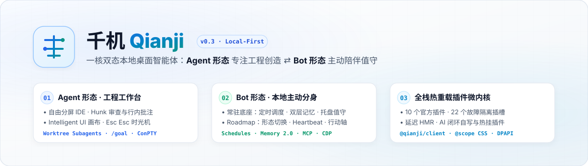
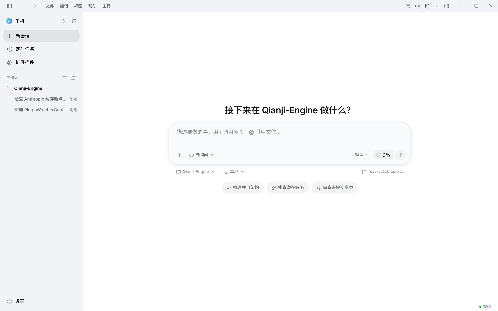
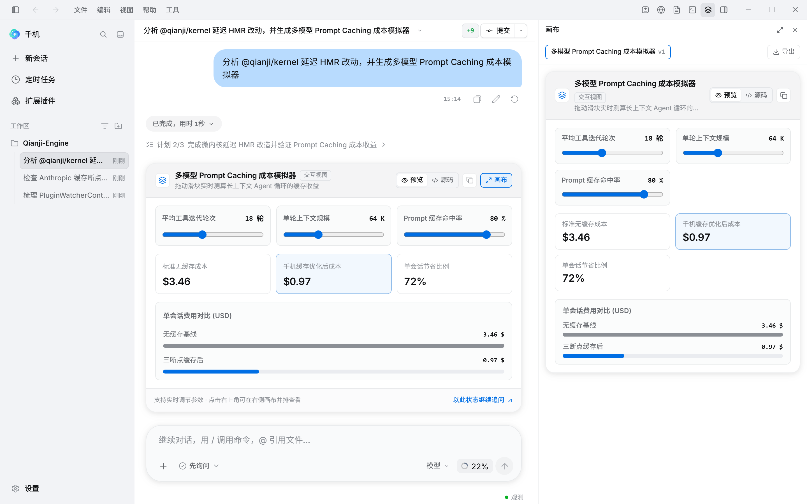
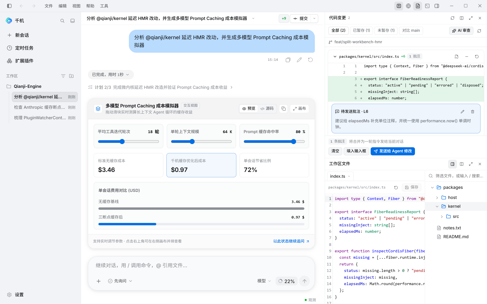
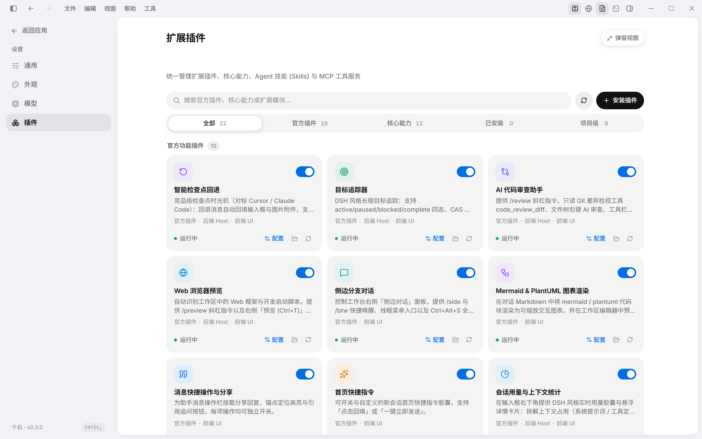
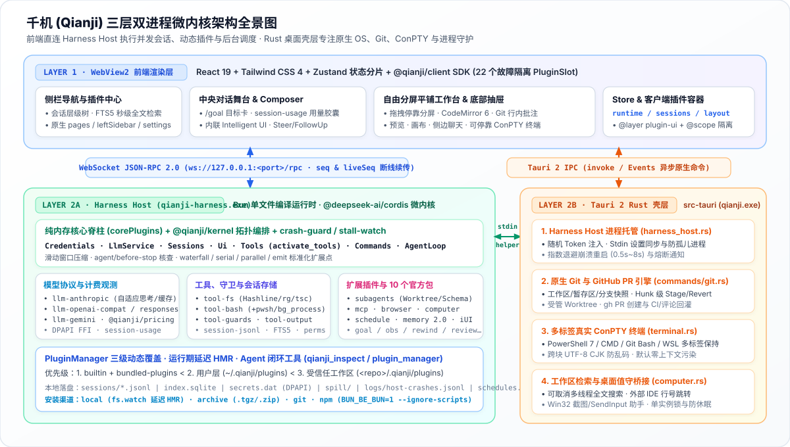

# 千机 (Qianji)



**融合 Agent 工作台、自主运行 Bot 与轻量级 IDE 的本地优先（Local-First）Windows 桌面创造环境。**

[**简体中文**](README.md) · [**English**](README.en.md)

[](LICENSE)
[](#快速开始)
[-6E56CF.svg)](docs/SYSTEM_DESIGN.md)
[](#系统架构)

[界面预览](#界面预览) · [为什么选择千机？](#为什么选择千机) · [核心能力](#核心能力) · [系统架构](#系统架构) · [Monorepo 模块矩阵](#monorepo-模块矩阵) · [快速开始](#快速开始) · [安全与隐私模型](#安全与隐私模型) · [文档导航](#文档导航)

---

**千机（Qianji）**（v0.3 之前原名 *Pi Desktop*）是一款 **100% 本地运行** 的桌面级 AI 创造环境，其核心引擎是基于微内核架构自研的 **Harness Host**（`qianji-harness.exe`）。单个宿主进程即可承载所有并发工作区会话、子代理与后台定时任务，将 Agent 状态机循环、模型协议适配、工具管线、权限策略、会话存储、MCP 桥接、浏览器控制、桌面键鼠自动化（Computer Use）以及生成式交互界面（**Intelligent UI**）全部组织为可热重载的 [Cordis](https://github.com/cordiverse/cordis) 插件。

千机 **零外部 CLI 运行时依赖（无需用户预装 Node.js 或 Bun）**，**无云端账号绑定或遥测上传**。首次启动时，旧版 `~/.pid` 数据与 `%APPDATA%/pid-desktop` 设置会自动无损迁移至 `~/.qianji` 与 `%APPDATA%/qianji`。

> [!NOTE]
> 千机是独立的开源项目，与 OpenAI、Anthropic 或 Google 无隶属或背书关系。文档中提及的 Codex、Claude Artifacts 或 Grok 仅用于说明交互范式参考。

---

## 界面预览

| 新会话工作台首页 (Home & Composer) | Intelligent UI 交互组件与右侧分屏画布 |
| :---: | :---: |
| <br/><sub>支持本地/Worktree 环境切换、分组模型与推理等级选择、快捷启动卡片</sub> | <br/><sub>在对话流内实时生成可交互计算器/图表卡片，并在右侧画布并排展开</sub> |
| **右侧七合一原生 IDE 工作台与 Git 审查** | **连接器与全栈动态插件管理中心** |
| <br/><sub>内置文件树、CodeMirror 6、Hunk 级 Git Stage/Revert 审查与侧边聊天</sub> | <br/><sub>统一管理 MCP 服务桥接、CDP 自动化浏览器、桌面控制与热重载扩展模块</sub> |

---

## 为什么选择千机？

| 维度 | 传统 CLI / 云端 Agent 工具 | 千机 (Qianji) |
| :--- | :--- | :--- |
| **运行与调度架构** | 每个任务启动独立进程，或将代码上传至远程云端容器执行 | **单进程微内核宿主**：单个单文件 `qianji-harness.exe` 在隔离的 Cordis Fiber 作用域内并发承载所有会话、子代理与定时任务（[ADR 0001](docs/adr/0001-harness-host-process.md)） |
| **工作台交互形态** | 纯终端 TUI 界面，或依附于编辑器的窄侧边栏对话插件 | **三合一原生工作台**：集流式多轮对话、自由分屏平铺右侧工作台（`文件与 CodeMirror 6` / `Git 审查` / `Web 预览` / `侧边聊天` / `Intelligent UI 画布` / `终端` / `系统可观测` 与自适应检查器）以及底部多标签 ConPTY 终端于一体 |
| **数据与凭据主权** | 会话记录保存在云端，或将 API Key 明文写入本地配置文件 | **100% 本地存储 + DPAPI 硬件级加密**：追加写 JSONL 会话日志（`~/.qianji/sessions`）、离线 SQLite FTS5 双语检索（`~/.qianji/index.sqlite`）及 Windows DPAPI 密钥存储（`secrets.dat`） |
| **全栈可扩展性** | 编译期静态固化的内置工具，或仅支持纯文本提示词扩展 | **全栈动态插件与零刷新 HMR**：支持 `builtin` < `user` < `workspace` 三层覆盖、10 个官方内置插件、22 个故障隔离 `<PluginSlot>` UI 扩展点与 `@qianji/client` SDK，运行中自动延迟 HMR 避免打断任务（[ADR 0016](docs/adr/0016-dynamic-plugins-and-hmr.md)） |
| **工作区操作安全** | 全量覆写文件难以回退，或缺乏细粒度执行拦截 | **轮次快照与多层门禁**：每轮可写操作前自动建立无侵入 Git 快照（`refs/qianji/checkpoints`），配合工具审批门禁、默认禁止 `git push --force` 与 Windows Job Object 轻量进程沙箱 |

---

## 核心能力

### 1. 多模型 Agent 核心与会话引擎
- **四大原生流式协议适配与自适应推理**：原生支持 **Anthropic Messages**（`/v1/messages`，支持 Claude 4.6+ / 5 自适应思考 `thinking: { type: "adaptive" }` 与 `output_config.effort`、会话级多断点 Prompt Caching 与 `/v1/models` 上下文窗口发现，[ADR 0018](docs/adr/0018-anthropic-adaptive-thinking-and-caching.md)）、**OpenAI Chat Completions**（`/v1/chat/completions`，自动推理模型 `reasoning_effort` 推断与 HTTP 400 参数回退，兼容 DeepSeek、OpenRouter、Ollama、vLLM）、**OpenAI Responses**（`/v1/responses`，适配 o 系列与 GPT-5 深度推理）以及 **Google Gemini**（`streamGenerateContent`）（[ADR 0007](docs/adr/0007-llm-layer.md)）。
- **多协作模式与实时干预**：支持在会话中随时切换 `Execute`（执行）、`Plan`（规划）与 `Ask`（问答）模式；运行中途可随时注入 `steer` 纠偏指令，或编辑重排 `followUp` 待办队列；内置 `update_plan` 分步计划追踪与 `agent/before-stop` 停止前核查钩子。
- **进程内受控子代理（`@qianji/subagents`）**：通过 `delegate_task` 在同一宿主进程内派生并行子会话，支持按角色配置模型与推理强度（`roleModels`）、结构化 JSON 输出校验（`outputSchema`）、**独立 Git Worktree 隔离执行（`isolateWorktree: true`）** 与顺序补丁合入（冲突补丁留存 `.qianji/subagent-patches/*.patch`）、在 `workspace-write` 边界内按需启用验证型 Shell 与诊断工具（`allowShell: true`），以及父会话联动中止与无值守状态传播（`ui.markUnattended`）（[ADR 0010](docs/adr/0010-subagents-mcp-usage.md)、[ADR 0022](docs/adr/0022-agent-capability-enhancements.md)）。
- **上下文压力治理、滑动压缩与事件溯源会话**：基于 `compactAtContextRatio`（默认 `0.8`）在接近模型窗口上限前主动压缩，运行中采用滑动窗口保留最近完整工具步骤（`keepRecentTokens`），摘要请求超长时逐级收缩重试；`@qianji/tool-output` 对超过 50,000 字符的工具输出自动截断并溢出保存至 `~/.qianji/spill/`（[ADR 0019](docs/adr/0019-context-pressure.md)）。追加写 JSONL 日志支持非破坏性 `rewind`（可选 `summarizeDropped` 注入死胡同分支摘要）、`fork`/`clone`、Markdown 导出及异步构建的 SQLite FTS5 中英双语全文检索（[ADR 0004](docs/adr/0004-session-format.md)、[ADR 0022](docs/adr/0022-agent-capability-enhancements.md)）。
- **工具调用保护与按需延迟激活**：`@qianji/tool-guards` 为工具调用提供默认 10 分钟时限与中止宽限剥离，并在模型连续 3/5/8 次重复相同调用时注入换路提醒（[ADR 0020](docs/adr/0020-tool-guards.md)）；`@qianji/tools` 支持 `activate_tools` 延迟加载机制，将 `browser`、`computer`、`code_intelligence`、`process`、`plugin_dev` 及大型 MCP 服务工具按需注入上下文。
- **离线 Token、耗时与成本可观测性**：精确采集输入、输出、缓存命中及 `reasoningTokens`，通过 `@qianji/pricing` 本地费率表实时估算单次会话与全局累计美元开销，并由官方插件 `session-usage` 在输入框旁展示实时上下文构成与 `/usage` 报告。

### 2. Intelligent UI 与分屏交互画布
- **生成式交互组件（`@qianji/intelligent-ui`）**：模型可主动调用 `render_ui` / `update_ui`（或由用户输入 `/ui <需求描述>` 触发，支持 `/ui clear`），在对话流中直接生成可交互微应用卡片，并在右侧工作台「画布」面板中并排展开。
- **双渲染引擎驱动**：
  - **原生声明式引擎 (`declarative`)**：零 JS 脚本配置滑块、数值、下拉、开关控制器，支持 `Math.*` 实时公式计算指标卡、柱状/折线/面积/环形图表、可搜索数据表、多标签页、核对清单以及一键回填对话的动态表单。
  - **受控沙箱引擎 (`html`)**：通过受控回环沙箱端口与严格 CSP 运行自包含的 HTML/CSS/SVG/Canvas 微应用，在隔离的微应用 iframe 内注入 `--pi-*` 主题色彩变量，支持多版本历史切换与 `window.piUI.sendPrompt()` 双向交互桥接（注：宿主客户端工作台插件另行使用 `@qianji/client` 与 `--qj-*` 语义令牌）。

### 3. 浏览器控制、Computer Use 与 MCP 生态
- **Grok 风格浏览器自动化（`@qianji/browser`）**：基于本机 Edge、Chrome 或 Chromium 的 CDP 协议提供 11 个按需激活的 `browser_*` 工具（`browser_navigate`、`browser_inspect`、`browser_click`、`browser_type`、`browser_screenshot` 等）与 `/browser-diagnose` 命令，支持页面元素编号引用、**按 Agent 会话隔离浏览器实例**、工作区内受限上传下载与空闲自动回收（[ADR 0012](docs/adr/0012-browser.md)）。
- **Windows 原生桌面控制（`@qianji/computer`）**：提供 11 个按需激活的 `computer_*` 桌面视觉与键鼠工具（`computer_sources`、`computer_start`、`computer_screenshot`、`computer_click`、`computer_type` 等），按会话隔离观察（`observe`）与控制（`control`）状态，交互输入受独立审批门禁保护（[ADR 0011](docs/adr/0011-computer-and-schedule.md)）。
- **完整 MCP 宿主（`@qianji/mcp`）**：后台非阻塞连接本地换行帧 **STDIO** 与远程 **Streamable HTTP** MCP 服务器；自动将发现的工具注册为 `mcp__<server>__<tool>`（超过 8 个工具的大型服务自动纳入 `activate_tools` 延迟激活），支持 `notifications/tools/list_changed` 热刷新、指数退避重连、Resources 列表/读取/订阅（`/mcp-resources`、`/mcp-read`）、Prompts 模板解析（`/mcp-prompts`）以及 DPAPI 加密凭据注入。

### 4. 集成 IDE、多面板平铺工作台、精准代码工具与 Git 审查
- **自由分屏平铺工作台（Multi-Pane Split-Tile Right Workbench）**：支持垂直/水平自由分屏、分割线拖拽调比、按住面板标题栏拖拽停靠/互换、单面板最大化以及自适应布局的「环境与上下文检查器」（单独停靠 / 侧栏常驻 / 悬浮弹层），集成 **工作区代码空间**（目录树、流式全文搜索、CodeMirror 6 多标签编辑器与自定义文件预览器）、**Git 代码审查（Review）**、**Web 预览（`/preview`）**、**侧边对话（`/side`、`/btw`、`Ctrl+Alt+S`）**、**Intelligent UI 画布**、可停靠至右侧或底部的 **ConPTY 终端** 以及动态插件面板（如 `observability` 系统可观测面板）。
- **精准代码读写、极速检索与受管后台进程（[ADR 0021](docs/adr/0021-powershell-fallback.md)、[ADR 0022](docs/adr/0022-agent-capability-enhancements.md)）**：
  - `@qianji/tool-fs` 支持 `read(..., { hashlines: true })` 行内容哈希锚点与 `edit` 多段 `HashlineEdit` 原子修改（支持 `±20` 行漂移自动重定位）、`grep` 优先调用 `ripgrep`（`rg`）高速检索并无缝回退纯 Node 遍历，以及按需激活的只读 `diagnostics` 工具（JSON 语法与本地 `tsc --noEmit` 诊断）。
  - `@qianji/tool-bash` 在未安装 Git Bash 的 Windows 系统上自动回退为 **`powershell` 工具**（权限策略与轻量沙箱完全对齐）；支持 `background: true` 派生会话隔离的受管后台进程，并通过 `bg_process`（`list`/`logs`/`wait`/`stop`）增量读取日志，随会话关闭或子代理结束自动回收进程树。
- **Codex 风格 Git Review、行内批注与 PR 闭环**：支持查看未提交、已暂存、未暂存、上一轮快照（Turn Checkpoint）、分支对比与历史提交 Diff；支持 Hunk 级暂存、取消暂存与丢弃；支持直接在 Diff 代码行添加行内批注并批量发送给 Agent 修改；集成 `gh` CLI 实现桌面端一键生成并创建 Pull Request，以及将 PR 审查意见与 CI 失败日志一键回灌对话自动修复。
- **无侵入 Git 快照与智能时光机回退**：每轮可写操作前自动在私有引用 `refs/qianji/checkpoints` 下创建工作区快照（绝不污染真实的 `.git/index`）；`smart-rewind` 插件提供 `/rewind`、双击 `Esc` 时间线、三态回退（对话与代码 / 仅对话 / 仅恢复代码）、草稿暂存保护与一键撤销回退（[ADR 0009](docs/adr/0009-feature-plugins.md)）。
- **受管 Git Worktree 与多标签真实终端**：支持在独立 Git Worktree 中开启新任务；多标签 ConPTY 终端（`Ctrl+J` 打开底部面板，亦可停靠至右侧工作台，支持 PowerShell 7、Windows PowerShell、CMD、Git Bash、WSL）。**终端输出默认绝不自动塞入模型上下文**，仅在用户主动点击“发送到对话”时按需引用。

### 5. 自主运行 Bot、长程目标、渐进式记忆 2.0 与全栈插件中心
- **本地无人值守定时任务（`@qianji/schedule`）**：支持按 `hourly`、`daily`、`weekdays`、`weekly` 周期调度本地任务，强制运行于无人值守安全权限模式（`read-only`、`ask` 或 `workspace-write`，严禁静默 `full-access`），完整保留运行历史与结果会话链接（[ADR 0011](docs/adr/0011-computer-and-schedule.md)）。
- **长程目标追踪器（`plugins/goal-tracker`）**：提供 `/goal` 斜杠指令与 `create_goal` / `get_goal` / `update_goal` 工具，在输入框上方展示验收清单控制卡，运行中注入 `<goal-reminder>` 防偏航提醒，并在停止前自动执行验收核查续跑。
- **渐进式双层记忆 2.0（`@qianji/memory`）与技能中心（`SKILL.md`）**：全局记忆（`~/.qianji/memory.md`）与项目记忆（`<workspace>/.qianji/memory.md`）独立开关与编辑；超出 `inlineMaxChars`（默认 4,000 字符）时自动转为 `<memory mode="indexed">` 分节索引目录以节省上下文 Token，配合 `desktop_memory` 的 `search`、切片 `read` 与 `upsert_section`（写入前强制弹出 Unified Diff 审批）；内置技能中心管理 `~/.qianji/skills`、`.qianji/skills`、`.agents/skills` 与插件附带技能，实时同步 `/skill:<name>` 斜杠指令。
- **统一插件中心、`@qianji/client` SDK 与 10 个官方内置插件（[ADR 0016](docs/adr/0016-dynamic-plugins-and-hmr.md)、[ADR 0017](docs/adr/0017-plugin-trust-model.md)）**：
  - 统一 **插件中心（Plugins Hub）** 集中管理核心能力（`builtin`）、10 个官方功能插件（`code-review`、`diagram-viewer`、`goal-tracker`、`message-actions`、`observability`、`quick-prompts`、`session-usage`、`side-chat`、`smart-rewind`、`web-preview`）、用户插件与工作区插件。
  - 前端通过稳定的 `@qianji/client` SDK（`src/sdk/index.ts`）与 22 个故障隔离 `<PluginSlot>` 扩展点（左侧栏导航页与自定义分区、设置左侧导航 `settings.pages` 与追加卡片 `settings.sections`、右侧工作台与底部抽屉标签页、窗口菜单与上下文菜单、全局快捷键、Markdown 围栏代码块渲染器、自定义文件预览器、输入框横幅/状态胶囊、全局浮层等）无缝融入原生界面，样式通过 `@layer plugin-ui` + `@scope` 严格隔离。
  - 支持从本地目录（开启文件监听 HMR，且在 Agent 运行期间自动延迟热重载以防打断流式对话）、`.tgz`/`.zip` 归档、Git 仓库或 npm（复用内嵌 Bun 执行 `--ignore-scripts` 安装）；内置 Agent 闭环插件工具 `qianji_inspect` 与 `plugin_manager`（配合离线 `plugin-types/` 声明实现自省、脚手架生成、`verify` 编译校验与一键挂载）及 `observability` 全链路闪退取证（`/logs`）。

---

## 系统架构

> 完整的系统架构设计、序列图、状态树设计与数据落盘规范请参阅 **[系统设计文档 (`docs/SYSTEM_DESIGN.md`)](docs/SYSTEM_DESIGN.md)** 与 **[架构决策记录 (`docs/adr`)](docs/adr/README.md)**。



- **Rust 桌面壳层（`src-tauri`）**：负责主窗口与系统托盘、防休眠后台线程、原生 Git 状态/Hunk 暂存/PR 命令、ConPTY 终端会话、工作区文件流式检索、`--computer-helper` 原生桥接以及 Harness Host 进程托管。Rust 通过 `stdin` 向 Host 下发配置，并在 Host 异常退出时按指数退避策略自动拉起恢复（[ADR 0001](docs/adr/0001-harness-host-process.md)、[ADR 0013](docs/adr/0013-desktop-settings-and-secrets.md)）。
- **Harness Host 引擎（`packages/host`）**：通过 `esbuild` 与 `bun build --compile` 编译为独立单文件可执行程序 `qianji-harness.exe`，终端用户无需安装 Node.js。前端通过本地回环 WebSocket 上的 JSON-RPC 2.0 协议直连 Host 完成所有 Agent、会话、模型、MCP、定时任务与插件操作（[ADR 0002](docs/adr/0002-client-protocol.md)、[ADR 0014](docs/adr/0014-frontend-harness-adapter.md)）。

---

## Monorepo 模块矩阵

仓库采用 npm workspaces（`packages/*`）组织，包含 36 个微内核与能力包，并由 ESLint 与测试守卫强制检查模块依赖边界（[ADR 0005](docs/adr/0005-repository-layout.md)）：

| 模块路径 | 角色定位 | 职责说明 |
| :--- | :--- | :--- |
| `packages/protocol` & `packages/rpc` | 共享协议契约 | JSON-RPC 2.0 消息类型、方法签名、应用设置契约、敏感字段脱敏规则与 Host RPC 注册总线 |
| `packages/kernel` | 微内核编排器 | Cordis 依赖元数据提取、确定性 Kahn 拓扑排序、Fiber 就绪状态探针与工作区隔离作用域 |
| `packages/host` | 宿主进程入口 | 进程启动、WebServer、PluginManager、客户端 TSX 实时打包器、DPAPI FFI 密钥库、崩溃取证与 `qianji_inspect`/`plugin_manager` |
| `packages/agent` & `packages/agent-loop` | Agent 核心 | Agent 服务契约（含 `agent/before-stop`）、流式增量类型、滑动窗口压缩与确定性多轮推理循环 |
| `packages/llm`, `llm-openai-compat`, `llm-openai-responses`, `llm-anthropic`, `llm-gemini` | 模型适配层 | 统一流式 LLM 接口与凭据引用抽象，以及 OpenAI Compat、OpenAI Responses、Anthropic（自适应思考与缓存）和 Gemini 原生适配器 |
| `packages/pricing` | 成本可观测性 | 离线模型单价目录及单次调用 / 会话累计美元成本估算 |
| `packages/session`, `session-jsonl`, `session-search-fts` | 会话与检索 | 事件溯源状态模型、分支与 rewind 摘要派生、追加写 JSONL 存储后端与 SQLite FTS5 全文检索索引 |
| `packages/tools`, `tool-fs`, `tool-bash`, `tool-guards`, `tool-output` | 工具、保护与沙箱 | 三段式工具管线与 `activate_tools` 延迟加载、Hashline 编辑/`rg`/`diagnostics`、Bash/PowerShell 回退与 `bg_process`、超时与重复调用守卫及 50K 溢出截断 |
| `packages/permissions` & `packages/checkpoints` | 权限与快照 | 有序 allow/confirm/block 规则引擎（含 `allowForcePush` 与 `powershell` 对齐）、权限模式管理与无侵入 Git 快照创建/还原 |
| `packages/system-prompt` & `packages/prompt-context` | 提示词组装 | 按序拼接系统提示词片段、`AGENTS.md`/`CLAUDE.md` 上下文发现与 `SKILL.md` 技能生命周期管理 |
| `packages/plan`, `memory`, `hooks`, `commands`, `ui` | 基础能力插件 | 分步计划追踪、支持渐进式索引与 Diff 审批的双层记忆 2.0、生命周期脚本钩子、斜杠命令总线与多传输交互通道 |
| `packages/subagents`, `mcp`, `browser`, `computer`, `schedule`, `intelligent-ui` | 高阶扩展插件 | 支持 Worktree 隔离与 `outputSchema` 的子代理、STDIO/HTTP MCP 客户端、CDP 浏览器、Windows 桌面控制、定时调度与生成式 UI |
| `packages/testkit` | 测试工具包 | 确定性脚本化 LLM Mock 提供商（`ScriptedProvider`）与黄金日志测试辅助 |
| `plugins/*` | 10 个官方内置插件 | `code-review`、`diagram-viewer`、`goal-tracker`、`message-actions`、`observability`、`quick-prompts`、`session-usage`、`side-chat`、`smart-rewind`、`web-preview` |
| `src/`（含 `src/sdk/`）& `src-tauri/` | 桌面客户端 | React 19 + Zustand 四分片前端工作台、`@qianji/client` 插件 SDK（`src/sdk/`）与 Tauri 2 Rust 原生壳层（`src-tauri/`） |

---

## 快速开始

### 环境要求
- **Windows 10 / 11 (x64)** 且已安装 **WebView2**（现代 Windows 系统均已预装）
- **Node.js >= 22** 与 `npm`
- **Rust stable**（`x86_64-pc-windows-msvc` 工具链）

### 开发运行与安装包构建

执行 `npm ci` 会安装所有工作区依赖与锁定的 Bun 编译器。运行 Tauri 开发或构建命令时，会通过 [`scripts/prepare-harness-host.mjs`](scripts/prepare-harness-host.mjs) 自动编译生成 `qianji-harness.exe`。

```powershell
# 1. 安装依赖
npm ci

# 2. 启动桌面端开发模式（自动构建并托管 Harness Host）
npm run tauri -- dev

# 3. 构建生产环境 Windows 安装包（NSIS / MSI）
npm run tauri -- build
```

### Headless CLI 命令行模式

编译后的 Harness Host 支持脱离桌面界面独立运行，便于脚本调用与自动化集成：

```powershell
npm run prepare:harness-host
.\src-tauri\resources\harness\qianji-harness.exe run --cwd . --model anthropic/claude-sonnet-4-20250514 "梳理当前仓库的模块架构"
```

### 质量与安全验证门禁

每次提交与 PR 均需通过以下 7 道自动化质量检查：

```powershell
npm run scan:secrets            # 扫描工作区与 Git 历史中的潜在硬编码密钥
npm audit --audit-level=high    # 检查 npm 依赖安全漏洞基线
npm run typecheck               # 全量类型检查（前端 UI、构建脚本、packages/* 与 E2E）
npm run lint                    # 代码规范与 ADR 0005 模块依赖边界检查
npm run test:unit               # 运行 Vitest 单元/黄金日志测试、exe 冒烟测试、仓库卫生与文档链接检查
npm run test:stress             # 运行 Host 高并发会话、高频流式增量与 HMR 内存泄漏压力测试
npm run test:e2e                # 在本机 Edge 浏览器中运行连接真实 Harness Host 的 Playwright E2E 测试

# 运行 Rust 单元测试
Push-Location src-tauri
cargo test
Pop-Location
```

---

## 安全与隐私模型

1. **权限模式、`powershell` 对齐与 Windows 轻量沙箱**：
   - `@qianji/permissions` 在 `tools/pre-execute` 阶段严格执行 `read-only`、`ask`、`workspace-write` 与 `full-access` 四档权限策略，`powershell` 回退工具与 `bash` 遵循完全一致的命令审批与拦截规则，且默认开启 `allowForcePush: false` 拦截 `git push --force`（[ADR 0021](docs/adr/0021-powershell-fallback.md)）。
   - 在非 `full-access` 模式下，`@qianji/tool-bash` 默认启用轻量级 Windows 进程沙箱（敏感环境变量脱敏、`.qianji/sandbox-tmp` 临时目录重定向、高危系统修改命令拦截与 Windows Job Object 进程数限制）。
   - 应用层审批门禁与进程级限制**不等同于**操作系统内核或虚拟化级隔离边界。处理不可信代码或无人值守任务时，可在“设置”中一键导出 `.wsb`（Windows Sandbox）或 `.devcontainer` 配置文件在强隔离容器中运行。
2. **静态凭据 DPAPI 加密**：
   - 模型提供商 API 密钥（`~/.qianji/secrets.dat`）与 MCP 服务器敏感凭据（`%APPDATA%/qianji/mcp-secrets.dat`）均调用 Windows 原生 `CryptProtectData`（DPAPI）按当前系统登录用户加密落盘，配置文件中仅保存不透明引用或 `$ENV_VAR` 环境变量名（[ADR 0013](docs/adr/0013-desktop-settings-and-secrets.md)）。
3. **插件信任模型与工作区显式信任门禁（[ADR 0016](docs/adr/0016-dynamic-plugins-and-hmr.md)、[ADR 0017](docs/adr/0017-plugin-trust-model.md)）**：
   - 启用的插件在 Host 进程与主 WebView 中以**完全信任**方式运行（无运行时 Worker 沙箱，插件清单亦无 `permissions` 字段；`<PluginSlot>` Fiber 边界与 `@scope` 仅分别隔离渲染异常与 CSS 样式级联，无法限制同进程代码能力或同步死循环）。
   - 风险边界建立在“插件来源”之上：用户级插件需主动安装启用，项目级插件（`<workspace>/.qianji/plugins`）、项目级配置（`<workspace>/.qianji/harness.json`）与项目记忆必须经用户显式信任（记录于 `~/.qianji/trusted-workspaces.json`）后才会加载；撤销信任将立即卸载对应工作区的隔离 Fiber。
4. **桌面控制与本地定时任务边界**：
   - 桌面观察工具（`computer_sources`、`computer_screenshot`、`computer_inspect`）为只读操作；键鼠注入必须在 `control` 模式下启动并通过独立审批门禁，且遵循 Windows UIPI 完整性级别限制。
   - 定时任务仅在电脑与千机运行期间在本地触发，会话强制标记为无人值守状态（任何需弹窗确认的操作自动拒绝），且严禁使用 `full-access` 权限。

如发现安全漏洞，请按 [SECURITY.md](SECURITY.md) 中的说明私密报告。

---

## 文档导航

- **[完整系统设计文档 (`docs/SYSTEM_DESIGN.md`)](docs/SYSTEM_DESIGN.md)** — 涵盖总体架构、核心子系统序列图、微内核扩展点、前端状态架构与本地数据存储规范。
- **[架构决策记录 (`docs/adr/README.md`)](docs/adr/README.md)** — 记录 V2 Harness Host 演进全过程的 ADR 0001 至 ADR 0022。
- **[仓库工程与 Agent 规范 (`AGENTS.md`)](AGENTS.md)** — 三平面模块边界、前端 CSS/组件预算、插件闭环开发工作流与 `AppSettings` 对齐清单。
- **[千机插件开发指南 (`skills/qianji-plugin-development/SKILL.md`)](skills/qianji-plugin-development/SKILL.md)** — 官方插件开发规范、`@qianji/client` SDK、`--qj-*` 令牌与脚手架模板说明。
- **[本地能力边界 (`docs/LOCAL_CAPABILITIES.md`)](docs/LOCAL_CAPABILITIES.md)** — 本地核心能力基线、持续演进方向与明确不做的范围边界。
- **[Codex UI 交互参考 (`docs/CODEX_UI_REFERENCE.md`)](docs/CODEX_UI_REFERENCE.md)** — 工作台、Composer 输入框与代码审查界面的视觉克制与交互规范。
- **[外观扩展规范 (`docs/appearance-extensions.md`)](docs/appearance-extensions.md)** — 自定义主题与外观扩展包格式说明。
- **[依赖安全基线 (`docs/DEPENDENCY_SECURITY.md`)](docs/DEPENDENCY_SECURITY.md)** — RustSec 与 npm 依赖审计基线及开源许可证盘点。
- **[发布检查清单 (`docs/RELEASING.md`)](docs/RELEASING.md)** 与 **[贡献指南 (`CONTRIBUTING.md`)](CONTRIBUTING.md)**。

---

## 开源许可

千机（Qianji）基于 [Apache License 2.0](LICENSE) 开源许可发布。随附第三方组件的版权与许可证声明请参阅 [THIRD_PARTY_NOTICES.md](THIRD_PARTY_NOTICES.md)。
